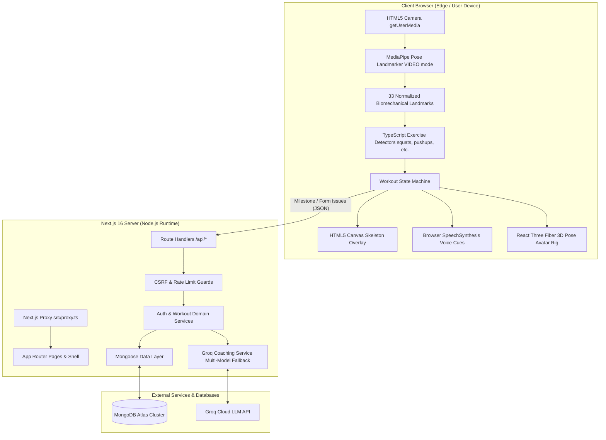
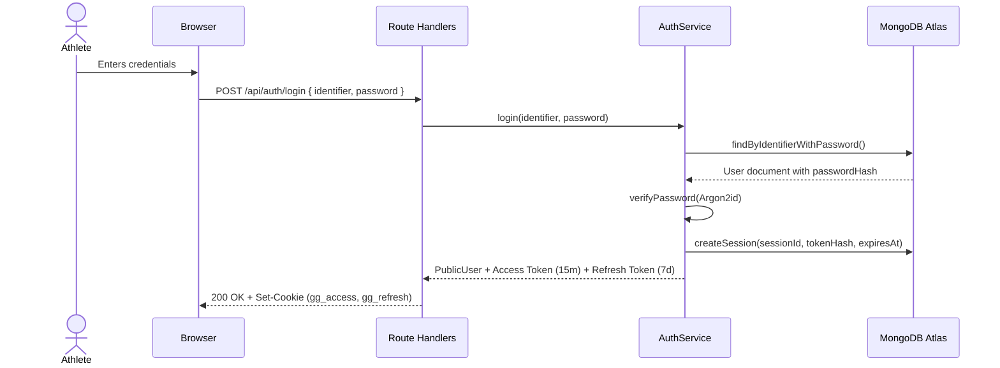
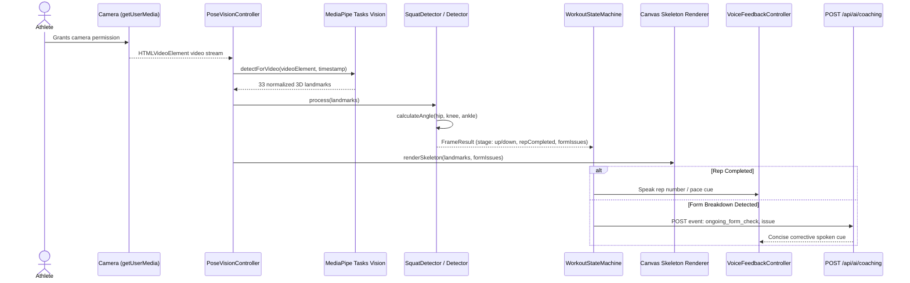
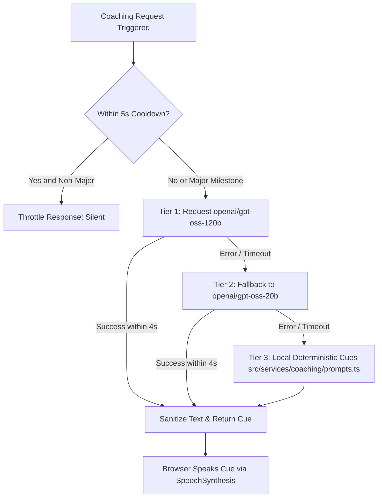

# GymGenie — Complete Architecture & System Design

> Comprehensive technical architecture documentation for GymGenie: a production-grade full-stack Next.js application delivering browser-side computer vision, real-time pose tracking, and server-side multi-tier AI coaching.

---

## 1. Project Overview

GymGenie is a web application designed to track human exercise biomechanics in real time directly inside the browser using client-side machine learning. It eliminates the need for expensive gym hardware or dedicated personal trainers by providing instant rep counting, form error detection, spoken voice cues, and AI-driven coaching advice.

---

## 2. Architecture Overview & Pattern

GymGenie is architected as a **Modular Full-Stack Monolith** running on **Next.js 16** with the App Router. 

### Core Architectural Decisions:
- **Client-Side Heavy Computer Vision:** Video processing and landmark inference execute entirely in the user's browser via WebAssembly and WebGL/WebGPU. No raw camera frames or biometric coordinates are ever streamed to the server.
- **Trusted Server-Side Operations:** User identity management, Argon2id password hashing, JWT signing, refresh token rotation, MongoDB persistence, and external Groq LLM requests run exclusively on the Node.js server.
- **Fail-Safe Data Access Layer:** Dual-mode repository architecture that automatically operates in-memory when MongoDB Atlas is unreachable.



---

## 3. Technology Stack

| Architecture Layer | Technology | Version | Purpose |
|---|---|---|---|
| **Framework** | Next.js App Router | `16.4.6` (Webpack) | Full-stack framework, Server Components & Route Handlers |
| **Language** | TypeScript | `^5.9.2` | Strict type safety across client and server |
| **Frontend Library**| React | `^19.1.1` | Concurrent UI rendering |
| **Styling** | Tailwind CSS | `^4.1.13` | Utility-first responsive design tokens |
| **Component Primitives**| Radix UI | Various | Accessible dialogs, dropdowns, switches, tabs |
| **Icons** | Lucide React | `^0.544.0` | Modern UI icon library |
| **Pose Estimation** | `@mediapipe/tasks-vision` | `^0.10.21` | Client-side 33-landmark 3D pose extraction |
| **3D Rendering** | Three.js / React Three Fiber | `^0.175.0` / `^9.1.2` | Interactive 3D wireframe avatar preview |
| **Animation** | GSAP & Framer Motion | `^3.13.0` / `^12.23.12` | Landing page choreography and layout transitions |
| **Data Visualizer** | Recharts | `^2.15.4` | Responsive volume, progression, and distribution charts |
| **Database & ODM** | MongoDB Atlas & Mongoose | `^8.19.0` | Document database for users, sessions, and workouts |
| **Authentication** | `jose` (JWT) & `@node-rs/argon2` | `^6.1.0` / Node crypto | Stateless access tokens & Argon2id hashing |
| **AI LLM Coaching** | Groq SDK (`groq-sdk`) | `^0.33.0` | Primary `openai/gpt-oss-120b`, fallback `openai/gpt-oss-20b` |
| **Voice Feedback** | Web Speech API | Native | In-browser zero-latency audio coaching |
| **Testing Suite** | Vitest & Playwright | `^3.2.4` / `^1.55.0` | Unit, integration (50 tests), and E2E automation |

---

## 4. Directory Structure

```
AI-Exercise-Tutor/
├── .github/workflows/          # CI/CD pipelines (verify, test, Vercel build & deploy)
├── docs/                       # Project technical documentation
├── public/
│   └── models/
│       └── pose_landmarker_full.task # 9.4 MB MediaPipe Pose Landmarker model asset
├── src/
│   ├── proxy.ts                # Next.js 16 route protection proxy
│   ├── app/                    # App Router pages and Route Handlers
│   │   ├── (auth)/             # Login, register, forgot-password, reset-password
│   │   ├── (dashboard)/        # Dashboard, workout, history, analytics, profile
│   │   ├── (marketing)/        # Landing page with 3D avatar & GSAP scroll
│   │   ├── api/                # REST Route Handlers (auth, users, workouts, ai, health)
│   │   └── globals.css         # Tailwind v4 theme and color variables
│   ├── components/
│   │   ├── analytics/          # Recharts volume, progression, and distribution charts
│   │   ├── animations/         # Page and landing GSAP/Framer choreography
│   │   ├── dashboard/          # KPI metric cards, streak tracker, quick-actions
│   │   ├── layout/             # Responsive AppShell (tabs + hamburger), brand mark
│   │   ├── profile/            # User profile, password, and preference forms
│   │   ├── three/              # Three.js 3D avatar rig and SVG fallback wireframe
│   │   ├── ui/                 # Reusable Radix UI design tokens (button, card, dialog)
│   │   └── workout/            # Live session view, history tables, setup forms
│   ├── config/
│   │   └── exercises.ts        # Exercise definitions, thresholds, MediaPipe constants
│   ├── features/
│   │   ├── auth/               # Client-side auth API client and token refresher
│   │   ├── exercise/           # Camera controller, MediaPipe loader, skeleton renderer
│   │   └── workout/            # Workout state machine and voice feedback controller
│   ├── lib/
│   │   ├── cookies.ts          # Auth cookie setters (gg_access, gg_refresh)
│   │   ├── csrf.ts             # Origin / Referer validation guard
│   │   ├── env.ts              # Zod server environment parser and validator
│   │   ├── errors.ts           # Centralized AppError and API JSON envelopes
│   │   ├── jwt.ts              # jose JWT signing and verification utilities
│   │   ├── logger.ts           # JSON structured logger with secret redaction
│   │   ├── mongodb.ts          # Mongoose connection manager and pooling
│   │   ├── password.ts         # Argon2id password hasher with timing guard
│   │   ├── rate-limit.ts       # Sliding-window rate limiter
│   │   └── validations/        # Zod validation schemas (auth, coaching, workout)
│   ├── models/                 # Mongoose database models (User, RefreshSession, Workout)
│   ├── repositories/           # Repository pattern data access + in-memory store
│   ├── services/
│   │   ├── analytics/          # Streak calculator and bucket aggregators
│   │   ├── auth/               # Authentication, session rotation, reset flows
│   │   ├── coaching/           # Groq AI coaching service with multi-model fallback
│   │   ├── exercise/           # Angles, detector factory, 5 exercise detector classes
│   │   └── workout/            # Idempotent workout persistence service
│   └── types/                  # Shared TypeScript interfaces and DTOs
└── tests/                      # Unit, integration, and E2E test suites
```

---

## 5. Security & Authentication Architecture

GymGenie implements defense-in-depth security:
1. **Route Protection (`src/proxy.ts`):** Checks for presence of `gg_access` cookie before letting clients hit `/dashboard`, `/workout/*`, `/history/*`, `/analytics`, or `/profile`. Unauthenticated visitors are redirected to `/login?next=...`.
2. **Server-Side Session Verification (`src/services/auth/session-guard.ts`):** Every API Route Handler and Server Component independently parses and verifies the cryptographic signature of the access token using `verifyAccessToken()` (`jose`).
3. **Argon2id Password Hashing (`src/lib/password.ts`):** Passwords are never stored in plaintext. If an unverified user logs in, a dummy Argon2id hash is computed to equalize response timing and prevent user enumeration.
4. **Token Family Rotation (`src/services/auth/auth.service.ts`):** Each login creates a `sessionId`. Every refresh atomically rotates the refresh token. If a rotated token is presented again, the entire token family is revoked immediately to neutralize session hijacking.
5. **CSRF Protection (`src/lib/csrf.ts`):** Enforces strict same-origin verification across all mutation HTTP methods (`POST`, `PATCH`, `DELETE`).



---

## 6. Live Workout & Vision Processing Lifecycle



---

## 7. Multi-Tier AI Coaching Architecture

To ensure high availability and responsiveness during physical exercise, AI coaching uses a three-tier fallback architecture:



---

## 8. Build, Deployment & Environment Configuration

### 8.1 Environments & Ports
- **Development Server:** `npm run dev` launches `next dev --webpack` on port `3000` (or `3001` if occupied).
- **Production Build:** `npm run build` executes `next build --webpack`.
- **Production Server:** `npm start` executes `next start`.

### 8.2 Environment Variables (`.env.example`)
```dotenv
NODE_ENV=development
APP_URL=http://localhost:3000

# Database
ATLAS_URI=mongodb+srv://<username>:<password>@<cluster-host>/gymgenie?retryWrites=true&w=majority
MONGODB_URI=

# Authentication Secrets (minimum 32 characters)
JWT_ACCESS_SECRET=
JWT_REFRESH_SECRET=
JWT_ISSUER=gymgenie
JWT_AUDIENCE=gymgenie-web

# Groq AI Coaching
GROQ_API_KEY=
GROQ_MODEL=openai/gpt-oss-120b
GROQ_FALLBACK_MODEL=openai/gpt-oss-20b
```

### 8.3 CI/CD Pipelines
- **CI Workflow (`.github/workflows/ci.yml`):** Runs on push and pull-requests to `main`. Executes `npm run lint`, `npm run typecheck`, `npm test`, and `npm run build` on Node.js 24.
- **CD Workflow (`.github/workflows/cd.yml`):** Automatically runs verify checks and deploys prebuilt assets to Vercel production using `secrets.VERCEL_ORG_ID`, `secrets.VERCEL_PROJECT_ID`, and `secrets.VERCEL_TOKEN`.
