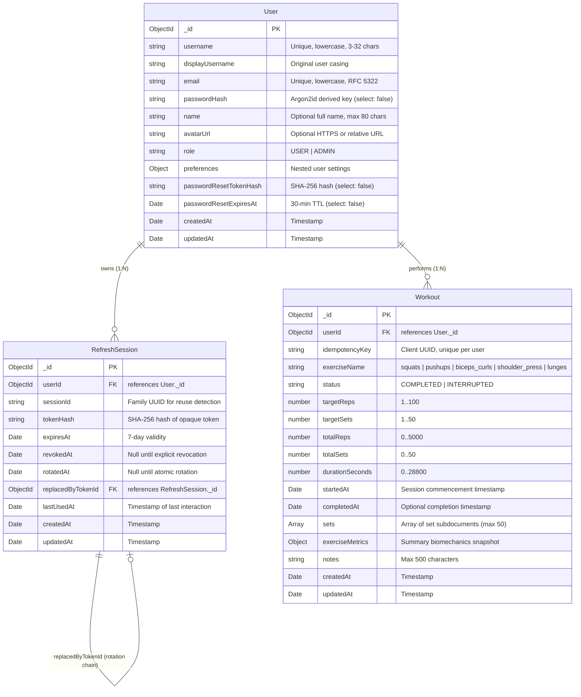

# GymGenie — Database Structure & Schema Specification

> Production-grade documentation of GymGenie's MongoDB database layer, Mongoose models, data access repositories, schema validations, and indexing strategy.

---

## 1. Database Overview

GymGenie uses **MongoDB Atlas** as its persistent system of record, managed through the **Mongoose** Object-Document Mapper (ODM). The database persists user identities, authentication sessions, and structured workout histories.

A dual-mode storage pattern is built directly into the data access layer:
- **Production Mode (MongoDB):** When `ATLAS_URI` or `MONGODB_URI` is provided, Mongoose manages connection pooling (pool size 10), automated index builds, and replica-set read/write semantics.
- **In-Memory Fallback Mode (`repositories/memory-store.ts`):** When running in air-gapped test environments, local offline setups, or during transient database outages, the application automatically falls back to an in-memory repository store without crashing.



---

## 2. Database Technology

| Attribute | Specification | Source Code Reference |
|---|---|---|
| **DBMS** | MongoDB 6.0+ / MongoDB Atlas | `lib/mongodb.ts` |
| **Driver / ODM** | Mongoose `^8.19.0` | `package.json`, `lib/mongodb.ts` |
| **Connection Pooling** | `maxPoolSize: 10`, `socketTimeoutMS: 15_000` | `lib/mongodb.ts:61-64` |
| **Server Timeout** | `serverSelectionTimeoutMS: 5000` (800ms for localhost) | `lib/mongodb.ts:62-63` |
| **Runtime Enforcement** | Node.js Server Only (`import "server-only"`) | `lib/mongodb.ts:1` |
| **Global Connection Cache** | `globalThis.__gymgenieMongooseCache` | `lib/mongodb.ts:13-26` |

---

## 3. Database Configuration

Database connection is established through `connectToDatabase()` in `lib/mongodb.ts`. The connection string is resolved in order:
1. `env.DATABASE_URI`
2. `env.ATLAS_URI`
3. `env.MONGODB_URI`

Valid connection strings must start with either `mongodb://` or `mongodb+srv://`. If the connection string is absent or unreachable, the application logs a warning and routes queries to `repositories/memory-store.ts`.

---

## 4. Collections Documentation

### 4.1 Collection: `users`
- **Model File:** `models/User.ts`
- **Repository Interface:** `repositories/user.repository.ts`
- **Mongoose Collection Name:** `users`

#### Field-Level Schema

| Field Name | BSON / TS Type | Required | Default | Validation & Rules | Indexing |
|---|---|---|---|---|---|
| `_id` | `ObjectId` | Yes | Auto `new ObjectId()` | 24-character hexadecimal identifier | Primary Key |
| `username` | `String` | Yes | — | Min 3, Max 32, trimmed, lowercase regex `/^[a-zA-Z0-9_.-]+$/` | Unique Index (`{ username: 1 }`) |
| `displayUsername`| `String` | Yes | — | Min 3, Max 32, trimmed; retains casing for display | — |
| `email` | `String` | Yes | — | Max 254 chars, trimmed, lowercase, valid email | Unique Index (`{ email: 1 }`) |
| `passwordHash` | `String` | Yes | — | Argon2id hash string `$argon2id$v=19$...`. Excluded by default (`select: false`) | — |
| `name` | `String` | No | `undefined` | Trimmed, Max 80 characters | — |
| `avatarUrl` | `String` | No | `undefined` | Trimmed, Max 512 characters. Must be HTTPS or relative `/` URL | — |
| `role` | `String` | Yes | `"USER"` | Enum: `["USER", "ADMIN"]` | — |
| `preferences` | `Embedded Document`| Yes | Subdoc defaults | Schema defined below | — |
| `passwordResetTokenHash` | `String` | No | `null` | SHA-256 hex string. Excluded by default (`select: false`) | Sparse Index (`{ passwordResetTokenHash: 1 }`) |
| `passwordResetExpiresAt` | `Date` | No | `null` | 30-minute validity timestamp. Excluded by default (`select: false`) | — |
| `createdAt` | `Date` | Auto | Timestamp | ISO Date generated by Mongoose | — |
| `updatedAt` | `Date` | Auto | Timestamp | ISO Date generated by Mongoose | — |

#### Embedded Document: `preferences`

| Field | Type | Required | Default | Bounds |
|---|---|---|---|---|
| `enableVoice` | `Boolean` | Yes | `true` | Browser SpeechSynthesis toggle |
| `enableAiCoaching` | `Boolean` | Yes | `true` | Server-side Groq cue toggle |
| `defaultRestSeconds` | `Number` | Yes | `60` | Min `0`, Max `600` seconds |

---

### 4.2 Collection: `refreshSessions`
- **Model File:** `models/RefreshSession.ts`
- **Repository Interface:** `repositories/session.repository.ts`
- **Mongoose Collection Name:** `refreshSessions`

Implements **RFC 6749 Token Family Rotation** with automatic reuse detection to invalidate rogue replay attempts.

#### Field-Level Schema

| Field Name | BSON / TS Type | Required | Default | Description & Lifecycle | Indexing |
|---|---|---|---|---|---|
| `_id` | `ObjectId` | Yes | Auto `new ObjectId()` | Session record identifier | Primary Key |
| `userId` | `ObjectId` | Yes | — | Foreign key reference to `users._id` | Compound (`{ userId: 1, sessionId: 1 }`) |
| `sessionId` | `String` | Yes | UUID v4 | Token family identifier shared across successive rotations | Index (`{ sessionId: 1 }`) |
| `tokenHash` | `String` | Yes | — | SHA-256 hex hash of the raw JWT refresh token | Unique Index (`{ tokenHash: 1 }`) |
| `expiresAt` | `Date` | Yes | `now + 7 days` | Refresh token expiration timestamp | TTL Index (`{ expiresAt: 1 }`, `expireAfterSeconds: 604800`) |
| `revokedAt` | `Date` | No | `null` | Populated upon user logout, password reset, or reuse invalidation | — |
| `rotatedAt` | `Date` | No | `null` | Populated atomically during refresh token rotation | — |
| `replacedByTokenId`| `ObjectId` | No | `null` | References successor `refreshSessions._id` in the rotation chain | — |
| `lastUsedAt` | `Date` | No | `null` | Timestamp of last rotation or validation | — |
| `createdAt` | `Date` | Auto | Timestamp | Creation timestamp | — |
| `updatedAt` | `Date` | Auto | Timestamp | Last update timestamp | — |

> **Audit & Purge Lifecycle:** Expired tokens are retained for an additional **7 days** post-expiry (`expireAfterSeconds: 604800` on `expiresAt`) before automatic removal. This guarantees that if a stale or leaked token is replayed after expiry, the system recognizes the token family and revokes the user's active sessions.

---

### 4.3 Collection: `workouts`
- **Model File:** `models/Workout.ts`
- **Repository Interface:** `repositories/workout.repository.ts`
- **Mongoose Collection Name:** `workouts`

Stores completed and interrupted workout sessions with aggregated totals and per-set breakdowns.

#### Field-Level Schema

| Field Name | BSON / TS Type | Required | Default | Validation & Constraints | Indexing |
|---|---|---|---|---|---|
| `_id` | `ObjectId` | Yes | Auto `new ObjectId()` | Workout session identifier | Primary Key |
| `userId` | `ObjectId` | Yes | — | Foreign key reference to `users._id` | Compound indexed |
| `idempotencyKey`| `String` | Yes | — | Client-generated UUID (8-128 chars). Prevents duplicate posts | Unique Compound (`{ userId: 1, idempotencyKey: 1 }`) |
| `exerciseName` | `String` | Yes | — | Enum: `"squats"`, `"pushups"`, `"biceps_curls"`, `"shoulder_press"`, `"lunges"` | Compound indexed |
| `status` | `String` | Yes | — | Enum: `"COMPLETED"`, `"INTERRUPTED"` | — |
| `targetReps` | `Number` | Yes | — | Integer, min `1`, max `100` | — |
| `targetSets` | `Number` | Yes | — | Integer, min `1`, max `50` | — |
| `totalReps` | `Number` | Yes | — | Integer, min `0`, max `5000` | — |
| `totalSets` | `Number` | Yes | — | Integer, min `0`, max `50` | — |
| `durationSeconds`| `Number` | Yes | — | Integer, min `0`, max `28800` (8 hours) | — |
| `startedAt` | `Date` | Yes | — | Workout commencement timestamp | Compound (`{ userId: 1, startedAt: -1 }`) |
| `completedAt` | `Date` | No | `undefined`| Completion timestamp | — |
| `sets` | `Array<WorkoutSet>`| Yes | `[]` | Array of set subdocuments (max 50 sets) | Subdocument schema |
| `exerciseMetrics`| `Mixed` | No | `undefined`| Key-value dictionary (max 16 keys, primitives only) | Summary biomechanics |
| `notes` | `String` | No | `undefined`| User remarks, max 500 characters | — |
| `createdAt` | `Date` | Auto | Timestamp | Mongoose timestamp | — |
| `updatedAt` | `Date` | Auto | Timestamp | Mongoose timestamp | — |

#### Embedded Subdocument: `sets` (`IWorkoutSet`)

| Field | Type | Required | Bounds | Description |
|---|---|---|---|---|
| `setNumber` | `Number` | Yes | Min `1`, Max `50` | Sequential set ordinal |
| `reps` | `Number` | Yes | Min `0`, Max `500` | Repetitions completed in this set |
| `durationSeconds` | `Number` | No | Min `0`, Max `28800` | Elapsed active time for this set |
| `completedAt` | `Date` | No | — | Timestamp when set reached target reps or completed |

---

## 5. Indexing Architecture & Query Patterns

```
Collection: users
├── { _id: 1 }                         (Primary Key)
├── { email: 1 }                       (Unique Index)
├── { username: 1 }                    (Unique Index)
└── { passwordResetTokenHash: 1 }      (Sparse Index)

Collection: refreshSessions
├── { _id: 1 }                         (Primary Key)
├── { tokenHash: 1 }                   (Unique Index)
├── { sessionId: 1 }                   (Index)
├── { userId: 1, sessionId: 1 }        (Compound Index)
└── { expiresAt: 1 }                   (TTL Index: expireAfterSeconds = 604800)

Collection: workouts
├── { _id: 1 }                         (Primary Key)
├── { userId: 1, startedAt: -1 }       (Compound Index: history list & streak calculation)
├── { userId: 1, exerciseName: 1, startedAt: -1 } (Compound Index: exercise progression)
└── { userId: 1, idempotencyKey: 1 }   (Unique Compound Index: idempotency protection)
```

---

## 6. Data Access Patterns & Core Queries

### 6.1 Atomic Refresh Token Rotation
Implemented in `repositories/session.repository.ts:66`:
```typescript
await RefreshSessionModel.findOneAndUpdate(
  {
    tokenHash,
    revokedAt: null,
    rotatedAt: null,
    expiresAt: { $gt: now },
  },
  {
    $set: {
      rotatedAt: now,
      lastUsedAt: now,
    },
  },
  { new: true }
);
```
If this query returns `null`, the system inspects `tokenHash` to determine if a previously rotated token was submitted. If so, `revokeSessionFamily(sessionId)` is immediately executed, invalidating all sessions in that family.

### 6.2 Idempotent Workout Persistence
Implemented in `repositories/workout.repository.ts:88`:
```typescript
// 1. Check existing record
const existing = await WorkoutModel.findOne({ userId, idempotencyKey });
if (existing) return { workout: toWorkoutDTO(existing), created: false };

// 2. Insert with catch for race condition on E11000 duplicate key
try {
  const created = await WorkoutModel.create({ ...payload });
  return { workout: toWorkoutDTO(created), created: true };
} catch (err) {
  if (err.code === 11000) {
    const raced = await WorkoutModel.findOne({ userId, idempotencyKey });
    return { workout: toWorkoutDTO(raced), created: false };
  }
  throw err;
}
```

### 6.3 Aggregated User Analytics
Implemented in `services/analytics/analytics.service.ts`:
- **Overview KPIs:** Queries `listForUserInRange(userId, from365, now)` to calculate total workouts, completion count, total reps, cumulative duration, and favorite exercise.
- **Streak Calculation:** Queries `listAllDatesForUser(userId, 365)` returning an array of unique UTC days. Calculates consecutive workout days anchored on today or yesterday.
- **Volume & Progression:** Aggregates daily activity points into weekly (7-90 days) and monthly (1-12 months) time buckets.

---

## 7. Migration & Transfer Procedures

### 7.1 Transferring Local MongoDB / Compass Data to Atlas
1. Export collections from local MongoDB:
   ```bash
   mongodump --uri="mongodb://localhost:27017/gymgenie" --out=./gymgenie-dump
   ```
2. Restore directly into Atlas cluster:
   ```bash
   mongorestore --uri="mongodb+srv://<username>:<password>@<cluster-host>/gymgenie" ./gymgenie-dump/gymgenie
   ```

### 7.2 Schema Limitations & Architectural Boundaries
- **No Per-Frame Biometrics Storage:** Individual video frame landmarks (33 coordinates per frame) are **never** persisted to MongoDB. Only aggregate metrics (`exerciseMetrics`) are saved.
- **Legacy SQLite Compatibility:** The legacy prototype stored users in SQLite without emails or passwords. New accounts must register through `/register` to generate valid Argon2id credentials.
